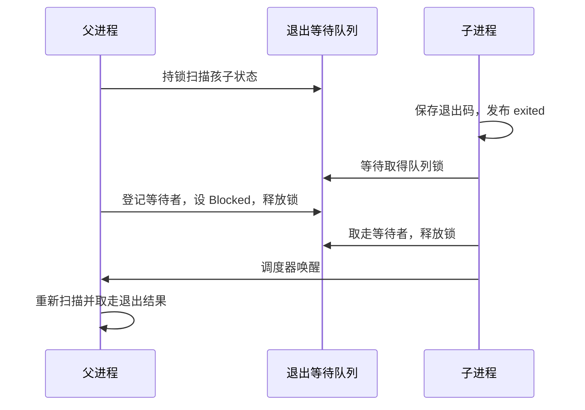

# 进程等待与信号状态：代码阅读及维护笔记

这份笔记对应 2026-09-09 的两批编码：wait4 正常退出子集、信号控制接口第一步。
后续 handler 投递和 rt_sigreturn 见[信号投递第一版](signal-delivery.md)。
它说明代码为什么这样写，以及后续修改需要保留哪些约束。任务状态以
[任务 07](../tasks/07-process-signals-wait4.md) 为准。

## 1. 问题：退出码与 wait 返回值混在了一起

原来的 syscall 61 只等指定 PID，返回退出码。Linux 用户程序期待的是：

```text
child: exit(42)
parent: wait4(child_pid, &status, 0, NULL)
返回值 = child_pid
status = 42 << 8 = 0x2a00
```

因此只修改返回值还不够：必须同时修改 dispatcher、用户库封装及测试。
[ABI 编码](../../mos_abi/src/process.rs)只有一行关键计算：

```rust
pub const fn exit_status(code: i32) -> i32 {
    (code & 0xff) << 8
}
```

`& 0xff` 保留退出码的低八位；信号终止要使用不同的状态编码，尚待实现。
旧 `user_lib::waitpid` 内部调用新接口后再解码，所以现有 init/shell 仍能读退出码。
新 `user_lib::wait4` 则直接暴露 PID、status 与 options。

## 2. 问题：父进程可能看到了“已退出”，却没看到退出码

[退出路径](../../mos_syscall/src/process.rs)按下面顺序发布结果：

```rust
shared.wait_status.store(status, Ordering::Relaxed);
shared.exited.store(true, Ordering::Release);
```

等待方用 `exited.load(Ordering::Acquire)` 检查标志。
Release/Acquire 建立同步关系：读到这次发布的 true，就能看到发布前保存的退出码。
此处 status 是已编码的正常或信号退出结果。关键不是把所有原子操作都改成最强顺序，
而是让“内容”先于“内容已就绪”发布。

维护时不能把这两行交换，也不能只读 exit_code 来判断是否已经退出。

## 3. 问题：检查结束与登记等待之间可能丢失一次唤醒

如果父进程发现孩子还活着，正准备睡眠时孩子退出，而通知已经发完，父进程就可能
永远睡下去。现在 [sys_wait4](../../mos_syscall/src/process.rs) 在扫描前持有统一退出队列锁，
直到登记等待并切换到 Blocked 状态才释放。

```rust
park_current(|task| {
    queue.wait_task(task.clone());
    ParkDecision::Park(queue)
});
```

这段代码不能脱离 [park_with_scheduler](../../mos_task/src/scheduler.rs) 单独理解：
调度器先设 Blocked，再释放传入的队列锁，最后切换任务。
退出方发布 exited 后，也要取得此队列锁来取走等待者，因此无法从这个间隙漏过去。
退出方取出等待者后释放队列锁，再进入调度器唤醒。



唤醒只代表“状态可能改变”，不代表目标孩子一定已退出，所以返回后必须重新扫描。
`WNOHANG` 在有孩子但没有退出结果时直接返回 0，不登记等待者，也不修改 status。

## 4. 问题：用户地址不能直接当内核指针用

status 可能是非法地址、内核地址、只读页，或者跨两个页面。fork 后它也可能位于
COW 页：父子暂时共用物理页，任何一方写入都必须先解除共享。

[copy_to_user / copy_from_user](../../mos_mem/src/virt.rs) 在 VMA 锁内完成权限检查和
物理地址读取／写回；写回先检查整个范围，再准备可写页，最后复制字节。
未触碰的匿名页可以按需分配；读匿名空页可直接得到零。读 COW 页不需要复制，写才需要。

wait4 的关键回收顺序是：

```rust
let copied = pcb.mem.copy_to_user(status, &encoded.to_ne_bytes());
mos_platform::smp::tlb_shootdown();
copied?;
// 成功写回之后，才允许执行 children.swap_remove(index)。
```

copy 可能已修改第一张页的 COW 映射，然后在后面的页失败，所以失败时也保留刷新动作。
当前 MOS 约定 EFAULT 后不消费子记录，用户可换一个有效地址重试；这不是对 Linux
所有错误路径的完整复刻。文件按需缺页和逐 CPU TLB 完成确认仍是技术债。

## 5. 实际应用揭示的问题：exec 后仍向旧地址写零

musl 会通过 set_tid_address 告诉内核：线程退出时向某个地址写零。
BusyBox exec 成另一个程序后，旧地址已经不属于新程序。旧代码退出时直接写该地址，
导致内核 page fault。

解决分两步：成功加载新程序后 `set_clear_child_tid(0)`；退出时也用受检写回，忽略
无效地址错误。这同时覆盖了合法旧程序留下的地址和用户刻意传入的坏地址。
测试不能只看子程序打印了文字，还要看它退出后 shell 能否继续执行下一条命令。

## 6. 下一部分：信号状态为何分成进程与线程两层

[ProcessSignals / ThreadSignals](../../mos_task/src/signal.rs) 分工如下：

| 状态 | 保存位置 | 原因 |
|---|---|---|
| action 表 | PCB，进程共享 | 同一进程的线程共享信号处置 |
| blocked 掩码 | TCB，每线程一份 | 某线程屏蔽信号不应直接屏蔽其他线程 |
| pending 位图 | 进程和线程各一份 | 为进程定向及线程定向信号保留不同来源 |

掩码中的第 `signal - 1` 位代表该信号。控制接口核心运算是：

```rust
SIG_BLOCK   => old | set,
SIG_UNBLOCK => old & !set,
SIG_SETMASK => set,
```

运算后用 `blockable` 清除 SIGKILL/SIGSTOP 对应的位。fork 复制调用线程的掩码和进程
action 表，孩子 pending 初始为空；exec 保留掩码和 SIG_IGN，重置其他 action 元数据。

[signal syscall](../../mos_syscall/src/signal.rs) 先把输入读到内核临时数组，再写 oldset/oldact，
所以输入和输出使用同一地址也不会覆盖尚未读取的参数。写出旧值成功后再提交新状态。
控制接口第一批曾拒绝自定义 handler；后续投递批次已经开放 handler/rt_sigreturn，
要求可执行的 handler/restorer 和 SA_RESTORER。SIGCHLD 的显式忽略／NOCLDWAIT
仍不支持，因为它们还影响子进程回收。pending 的投递与查询已有自身信号测试，
不能只用空集合查询来证明投递正确。

## 7. 测试怎么分工

控制接口批次结果：内核与全量用户态 release 构建成功，3 个 ABI 宿主测试通过；
下表中的用户态测试及 BusyBox 场景在单核和 4 核 QEMU 均通过。

| 测试 | 主要证明什么 |
|---|---|
| mos_abi 宿主测试 | 退出编码、结构体大小/字段偏移、64 位掩码运算 |
| test_process_baseline | stderr、64 次 fork/退出、重复回收 |
| test_wait4 | pipe 门控的 WNOHANG、任意孩子、EFAULT 重试、跨页、存活孩子的 COW 隔离 |
| test_signal_state | 信号查询与修改、别名指针、权限边界、fork 独立副本、exec 保留规则 |
| BusyBox sh/echo | 静态 musl 程序真实调用路径，特别是 exec 后能正常退出 |

pipe 门控比 sleep 猜测更可靠：父进程没写入管道，孩子就无法通过读操作，因此测试
能确定 WNOHANG 检查时孩子还活着。单核／4 核都跑是为了覆盖不同调度交错；通过这些
测试不代表已经证明所有多线程与内存并发路径正确。

复现前必须重新构建用户态、ramfs 和内核镜像。然后在仓库根运行：

```powershell
./tools/qemu-wait4.ps1 -Cpus 1
./tools/qemu-wait4.ps1 -Cpus 4 -MonitorPort 55564
```

脚本检查 PASS、panic 和超时，只清理自己启动的 VM。日志在 `build/wait4-qemu-1.log`
及 `build/wait4-qemu-4.log`。编译与运行结果不能混为一谈：`cargo check` 不会启动内核。

建议阅读顺序：ABI → syscall 分发 → process/signal 业务逻辑 → PCB/TCB → 内存复制
→ 用户态测试。维护每个新功能时，先写清它改变了什么用户可观察行为，再写正常、错误
和继承／并发场景的测试。

参考：[Linux waitpid](https://man7.org/linux/man-pages/man2/waitpid.2.html)、
[sigprocmask](https://man7.org/linux/man-pages/man2/sigprocmask.2.html)、
[sigaction](https://man7.org/linux/man-pages/man2/sigaction.2.html)、
[x86 内核 signal ABI](https://github.com/torvalds/linux/blob/master/arch/x86/include/uapi/asm/signal.h)。
